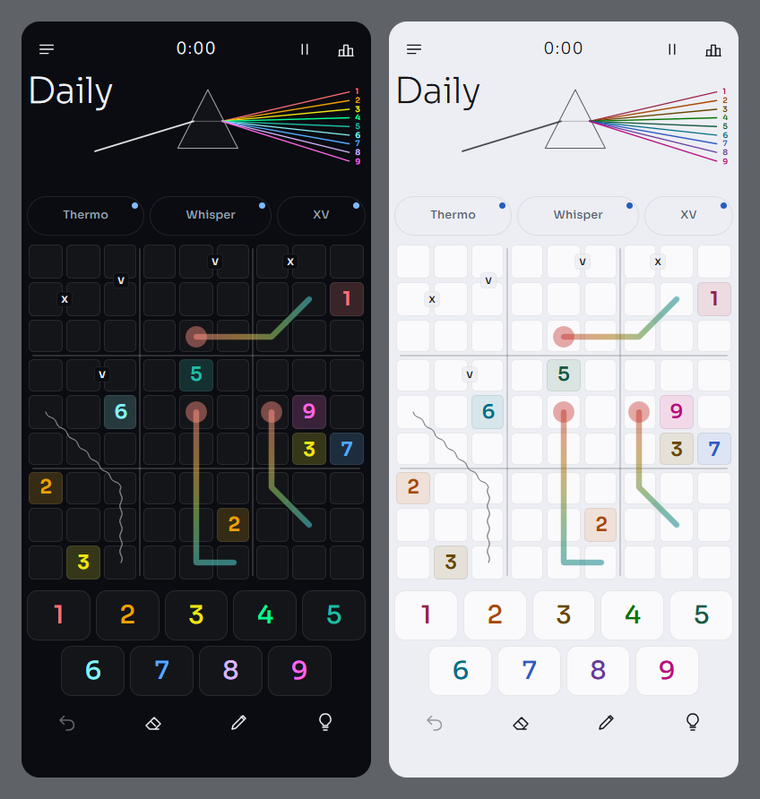
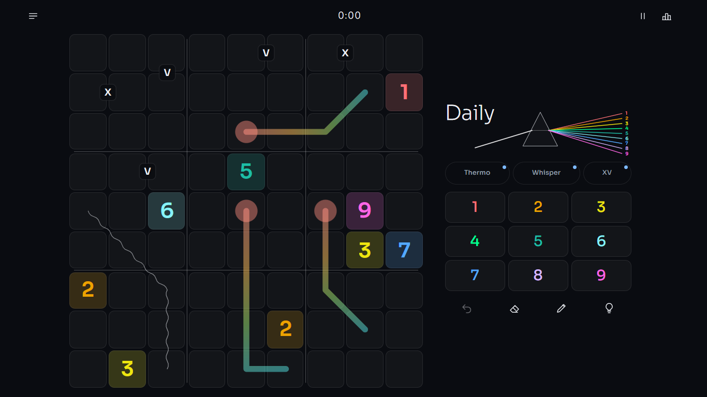

# Cellbound

Cellbound is a variant sudoku game that runs in the browser and installs as an app on phones and laptops. It opens straight into the day's puzzle, and every board is made or stored on your device. Progress stays in the browser's local storage, so there is no server, no account and no advertising, and after the first visit the whole app works offline.

Play it at [cellbound-sudoku.vercel.app](https://cellbound-sudoku.vercel.app).



## Modes

The Daily is one 9x9 puzzle a day, the same for everyone. It climbs from a gentle Monday with one rule to a hard Saturday, and Sunday brings a longer board with three rules. Each Daily is named after a constellation, and solving it on its own day keeps your streak going.

Run is a roguelite. You play five 9x9 boards in a row with three hearts, and every wrong digit costs a heart. Each board asks a little more than the last, from a gentle board with one rule to a medium final with three, so a whole run takes an experienced player about 45 minutes. Between boards you take one of three cards. A boon helps on the next board, a curse makes it harder and raises its score, and a bargain does a little of both. There is a daily run with the same boards and offers for everyone, free runs that are new every time, and five more cards to unlock by reaching milestones.

Fog opens on a 9x9 and hides most of the board. A correct digit clears the cells around it and shows the givens and clues underneath, while a wrong digit clears nothing.

Free play opens on a 9x9, with 6x6 a tap away, and lets you pick any mix of rules and a difficulty from 1 to 5, then plays an endless stream of boards. Sharing a result shares a link to that exact board.

Learn has a short lesson for the basics and for each rule, and every lesson ends with a small practice puzzle. Until you have done a rule's lesson, its chip on the board shows a dot, and tapping the chip offers the lesson.

## Rules

Every board keeps the classic rule that each row, column and box holds each digit once, then adds one or more of these.

| Rule | What it asks |
| --- | --- |
| Thermo | Digits rise from the round bulb to the far end of the line. |
| Arrow | Digits along the arrow add up to the digit in its circle. |
| Cage | Digits in the cage add up to its small total and never repeat. |
| Renban | The line holds a run of consecutive digits, in any order. |
| Whisper | Neighbours on the line differ by at least 3 on a 6x6 board and 5 on a 9x9. |
| Dots | A white dot joins digits one apart, a black dot a digit and its double. |
| XV | An X joins digits that sum to 10, a V digits that sum to 5. |
| Diagonal | Each diagonal holds every digit once. |
| Anti-knight | Equal digits are never a knight's move apart. |

## Playing

Tap or click a cell, then a number. On a keyboard, type the digit, move with the arrow keys or WASD, and erase with Backspace, Delete or 0. N switches to notes and Shift with a digit writes a single note, Z undoes and Y redoes (Ctrl+Z and Ctrl+Y work too), H asks for a hint, P pauses and Escape clears the selection.

A hint comes in three steps for the same deduction. The first shows where to look, the second names the rule that does the work, and the third places the digit and explains why. Mistake checking can be off, can show only digits that break a rule, or can mark every digit that differs from the solution. Fog and Run always check against the solution, because clearing fog and losing hearts depend on it.



## Look

Cellbound has one look, Prism, in a light and a dark version. Digits sit on glass cells, each digit in its own spectrum colour, under a band where a beam of white light splits into one ray per digit. On Auto the light or dark version follows your device, and Settings can keep either one.

Prism honours reduced motion, from the device or from Settings.

## Run it

You need Node.js 22.12 or newer.

```sh
npm install
npm run dev
```

Then open the address Vite prints. `npm run build` makes a production build in `dist/` with a service worker, and `npm run preview` serves it.

## Scripts

- `npm run dev` starts the dev server.
- `npm run build` type-checks and builds to `dist/`.
- `npm run preview` serves the production build.
- `npm test` runs the unit tests once, and `npm run test:watch` keeps them running.
- `npm run typecheck` checks the types.
- `npm run e2e` runs the browser tests in Edge, in WebKit (the engine of Safari) as an iPhone and an iPad, and in Firefox. They start a dev server and a production preview on their own. Run `npx playwright install webkit firefox` once first. Edge is the installed Microsoft Edge unless `PW_CHANNEL=chromium` is set.
- `npm run e2e:edge` runs the Edge projects only, which is the quick check.
- `npm run gen:daily` regenerates the stored Daily puzzles. Pass a range of months to choose them, for example `npm run gen:daily -- 2028-01 2028-12`.
- `npm run gen:practice` regenerates the Learn practice puzzles.

## How it is built

The app uses React 19 and TypeScript 7, built with Vite 8. Game state lives in zustand stores saved to local storage, and vite-plugin-pwa provides the service worker and the web manifest. The font comes from a Fontsource package, so nothing is fetched from a font service.

The puzzle engine in `src/engine` is plain TypeScript. It has a solver that proves each puzzle has one solution, a generator that grades difficulty by the techniques a logical solver needs, an estimate of how long a board takes an experienced player, the hint explainer built on that solver, and the fog layouts. Daily and Run boards are cut to that estimate. Boards for Free play, Fog and Run are made in a Web Worker, so the screen stays responsive while they are built. Dailies up to the end of 2027 are stored in `src/data/daily` and load a month at a time. Later dates are generated on the device from the same seed, so they still come out the same for everyone.

| Folder | What it holds |
| --- | --- |
| `src/engine` | Solver, generator, hints, Dailies and fog |
| `src/game` | The game store, settings and stats |
| `src/app` | The shell, the play screen and the other screens |
| `src/board` | The board and its layers |
| `src/themes` | The look, Prism |
| `src/modes` | Run and Learn |
| `scripts` | Puzzle generation for Dailies and lessons |
| `e2e` | Browser tests |

Unit tests use Vitest and browser tests use Playwright. The app's name is set once in `src/app/brand.ts`.

## Licence

MIT. See [LICENSE](LICENSE).
